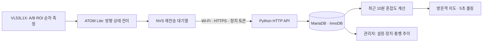

# 시스템 설계와 API

이미지는 외관 참고이고 최종 요구사항은 PDF의 마지막 선정 주제와 오차 대응 방식으로 해석했다. 정확한 내부 인원·예상 대기시간은 제공하지 않는다. 문서에 적힌 팀원에게 메시지나 업무 배정을 전송하지 않았다.



## 초기 혼잡도 모델

현재 10분 입장 I, 퇴장 O, 그 직전 10분 입장 P, 현재 운영 칸 수 S에 대해:

`score = (0.6×I + 0.4×max(0,I−O) + 0.2×max(0,I−P)) / S`

- score < 0.8: 여유, 0.8 이상 2 미만: 보통, 2 이상: 혼잡.
- 마지막 이벤트/heartbeat가 120초 초과거나 quality가 good이 아니면 확인 필요.
- 모든 계산은 `occurred_at` 기준이다. 재연결 때 늦게 도착한 10분 초과 이벤트는 현재 통행량에 더하지 않는다.
- 최근 구간만 사용하므로 하루 전체 누적 오차를 유지하지 않는다. 입·퇴장 차이는 내부 실제 인원이 아니다.
- 임계값·가중치는 **검증 전 초기 가설**이다. 실측 대기열 라벨과 비교해 교정해야 한다. 최근 기록 만료나 통신 단절로 단계가 바뀔 수 있다. 장기간 머무르는 이용자의 체류는 이 모델로 직접 알 수 없다.
- 관리자 초기화는 `reset_at` 이후 기록만 현재 계산에 반영한다. 원본 이벤트·통행 추이는 보존한다.

## DB

| 테이블 | 핵심 내용 |
|---|---|
| toilets | 이름, 운영 칸 수, 지도 좌표(%), 예외 초기화 시각 |
| devices | 장치 ID, 화장실 FK(1:1), 토큰 SHA-256, 마지막 수신, 품질 |
| sessions | 장치+부팅 ID의 마지막 순번 |
| events | 장치+부팅 ID+순번 UNIQUE, 방향, 발생/수신 시각 |
| settings | 업로드 지도(data URI) |
| audit | 장치 등록·계산 초기화 이력 |

한 HTTP 요청마다 MariaDB 연결과 트랜잭션을 열고 성공 시 commit, 오류 시 rollback한 뒤 cursor와 connection을 닫는다. 이벤트 수신은 장치 행을 `FOR UPDATE`로 잠가 같은 장치의 동시 요청을 직렬화하고 `(device_id, boot_id, seq)` UNIQUE 키로 중복 저장을 방지한다. 동일 이벤트 키의 동일 내용은 200/duplicate로 응답한다. 키가 같고 내용이 다르면 409, 새 키의 순번 역전도 409. 부팅 ID가 달라지면 순번 1부터 가능하며 이전 부팅 대기열도 재전송할 수 있다. 장치 시계는 UTC Unix 초, 30초 초과 미래/24시간 초과 과거는 400. 원본 이벤트 자동 삭제 정책은 현재 없으므로 긴 행사 운영 시 보관·백업 정책을 설정한다.

## HTTP API

모든 요청 본문은 JSON. 관리자는 POST /api/login 비밀번호 인증 후 HttpOnly·SameSite=Strict 쿠키로 세션을 유지하고, 장치만 `Authorization: Bearer <token>`을 사용한다. 방문객 API는 공개 읽기이며 방문객 화면에는 관리자 링크가 없다. 관리자는 /admin에 직접 접속한다. 토큰은 URL에 넣지 않는다.

| 메서드 / 경로 | 인증 | 기능 |
|---|---|---|
| GET /api/health | 없음 | HTTP·DB 가용성 |
| GET /api/status | 없음 | 지도, 시설, 단계, 연결, 갱신시각, demo 플래그 |
| GET /api/qr.svg | 없음 | 저장된 방문객 주소(없으면 PUBLIC_URL)의 QR SVG를 로컬 생성. 미설정 409 |
| POST /api/login | 없음 | password: 최초 1234. 8시간 관리자 쿠키 세션 발급 |
| POST /api/logout | 관리자 | 현재 세션 만료 |
| PUT /api/password | 관리자 | current_password, new_password(4~128자). 변경 후 다른 세션 만료 |
| POST /api/toilets | 관리자 | name, stalls, 선택적 x/y. 개수 고정 없이 추가 |
| DELETE /api/toilets/1 | 관리자 | 비활성화해 목록에서 제거·장치 수신 중지. 원본 기록 보존 |
| GET /api/admin | 관리자 | 장치 목록(토큰 제외) |
| GET /api/history?toilet_id=1 | 관리자 | 최근 2시간 입·퇴장 통행량, 10분 단위 12구간 |
| PUT /api/toilets/1 | 관리자 | name, stalls(1~100), x/y(3~97 정수 %) |
| PUT /api/visitor-url | 관리자 | url: http(s) 방문객 주소 저장, URL 내 사용자명·비밀번호 거부 |
| PUT /api/map | 관리자 | image: 최대 2MB PNG/JPEG data URI. SVG 거부 |
| POST /api/devices | 관리자 | id, toilet_id로 등록, token을 한 번 반환 |
| POST /api/reset | 관리자 | toilet_id의 혼잡도 계산 구간 초기화 |
| POST /api/demo | 관리자 | --demo일 때만 가상 기록 추가 |
| POST /api/events | 장치 | 통과 이벤트 저장 |
| POST /api/heartbeat | 장치 | device_id, quality(good/degraded/fault) |

```json
{
  "device_id": "atom-entrance-a",
  "boot_id": "a-new-random-id-per-boot",
  "seq": 1,
  "direction": "in",
  "occurred_at": 1793865600,
  "quality": "good"
}
```

위 시각은 형식 설명용으로 실행할 때는 현재 UTC Unix 초를 사용한다. 배터리 %는 측정원이 없으므로 계약에 포함하지 않는다. 시뮬레이터는 동일 API와 파일 대기열을 사용한다. 관리자 비밀번호는 별도 admin_credentials 테이블에 salt와 PBKDF2-SHA256(200,000회) 해시로 저장한다. admin_sessions에는 무작위 세션 토큰의 SHA-256과 만료 시각만 보관한다. 공개 settings 응답에는 인증 정보를 포함하지 않는다. 세션은 새로고침 후에도 유지되고 로그아웃·비밀번호 변경·만료 시 폐기된다. 장치 토큰은 원문을 DB에 저장하지 않는다.

## 실행 범위

현재는 소규모 시제품용 단일 프로세스 Python ThreadingHTTPServer와 별도 MariaDB 서버 구조다. 실사용과 시연은 각각 `database`, `demo_database`로 분리한다. 실제 행사 공개 운영 전 HTTPS 종단, 요청 제한, 관리자 계정 확장·로그인 시도 제한, 모니터링·MariaDB 백업, 운영 로그·보관 정책을 별도 배치한다. 역사적 혼잡 단계 스냅샷·설정 변경 이력 전체는 구현하지 않았고 현재 추이 화면은 **원본 통행량**이다. 실사용 초기 예시 시설은 두 곳이지만 추가·삭제로 개수를 자유롭게 바꿀 수 있다. 삭제는 active=0으로 보관해 이벤트 FK를 유지하며 해당 장치의 인증을 거부한다.

관리자 지도는 Pointer Events로 마우스/터치 드래그와 취소를 지원하고, 이동 초안은 저장 전까지 클라이언트에 유지한다. 좌표는 기존과 동일한 3~97% 정수 범위다. 방문객에게는 서버에 저장된 좌표만 제공한다. QR의 SVG는 서버에서 생성하고, PNG는 브라우저에서 흰 배경의 1024×1024 이미지로 변환해 다운로드한다. 이미지 파일을 서버 디스크에 쓰지 않는다.


## MariaDB QR 자동 연결 변경

- `POST /api/qr`: 관리자 세션 필요. 서버 public_url을 우선 사용해 SVG와 URL을 반환합니다. 없으면 브라우저 origin을 사용하되 로컬/사설 IP를 거부합니다. 기존 GET QR/수동 URL 저장 API는 호환성을 위해 유지합니다.
- `GET /api/admin`: `automatic_visitor_url`을 추가합니다.
- `tools/public_start.py`: MariaDB 설정을 재사용하고 기본 live Store를 만든 뒤 초기 관리자 비밀번호를 변경하고 서버를 바인딩합니다. Quick Tunnel URL을 받으면 server.public_url을 설정합니다. 종료 시 터널과 HTTP 서버를 닫으며 DB 데이터는 삭제하지 않습니다.
- `start_public_demo.bat`는 동일 실행기에 --demo를 전달합니다.


## 유료 서버 구매 전 배포 준비

- deploy/compose.yaml: MariaDB 11.4 + non-root Python 앱 + Caddy HTTPS, 영구 DB/인증서 볼륨, 자동 재시작 및 상태 검사. DB/앱 포트는 호스트에 게시하지 않습니다.
- RESTFLOW_DB_PASSWORD_FILE은 DB 비밀번호의 파일 입력을 지원하며 일반 환경변수보다 우선합니다.
- RESTFLOW_INITIAL_ADMIN_PASSWORD(_FILE)는 기본 비밀번호일 때만 최초 비밀번호를 적용합니다. 이미 변경한 비밀번호는 유지합니다.
- deploy/configure.py는 도메인·이메일과 비밀 파일을 생성하며 기존 비밀값을 보존합니다. deploy/install.sh는 실제 구매한 Ubuntu 24.04 서버의 /opt/restflow에서만 실행합니다.
- 백업은 한국 시간 03:00 로컬 SQL 압축 파일로 저장하며, 명시적 --confirm-replace 옵션으로 복원합니다. 자세한 단계와 미검증 범위는 docs/배포준비.md에 있습니다.
