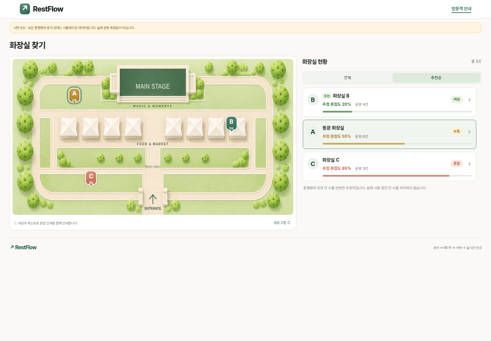
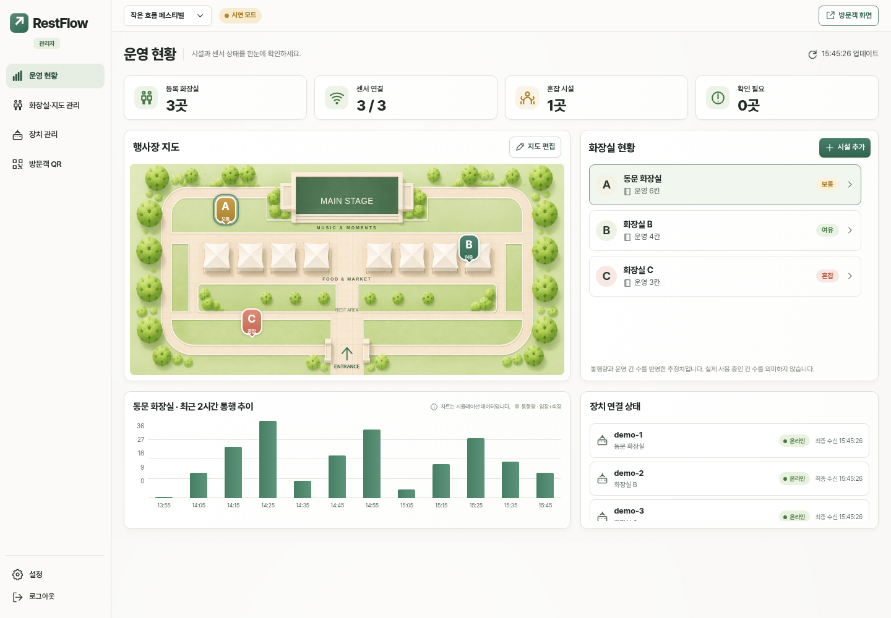
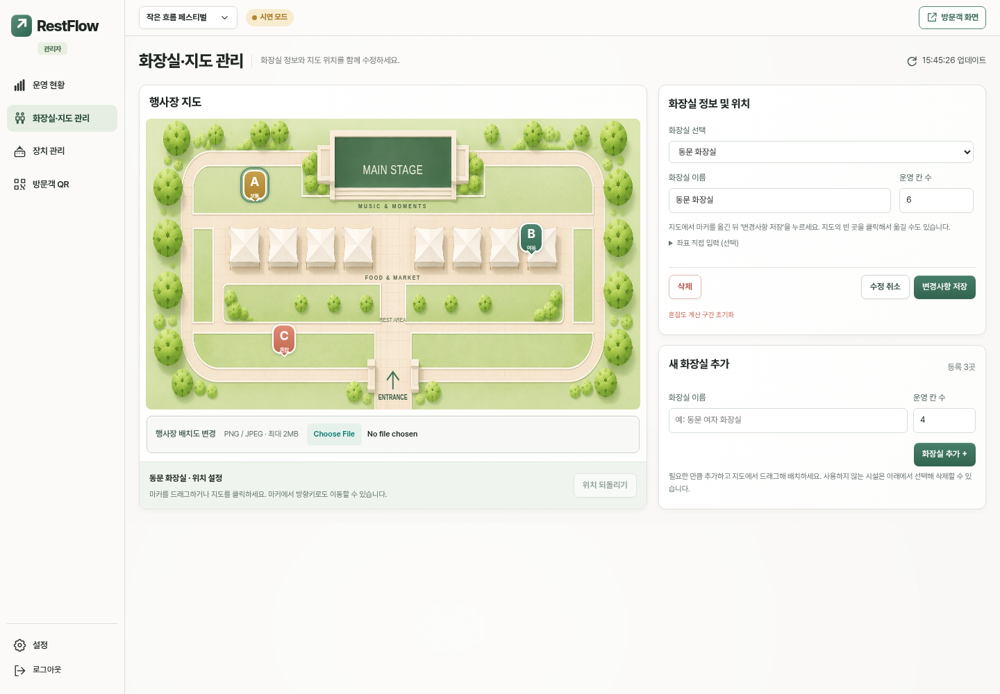
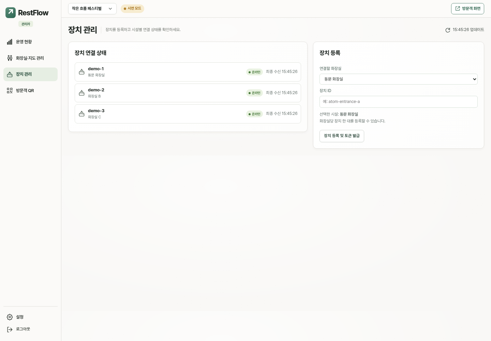
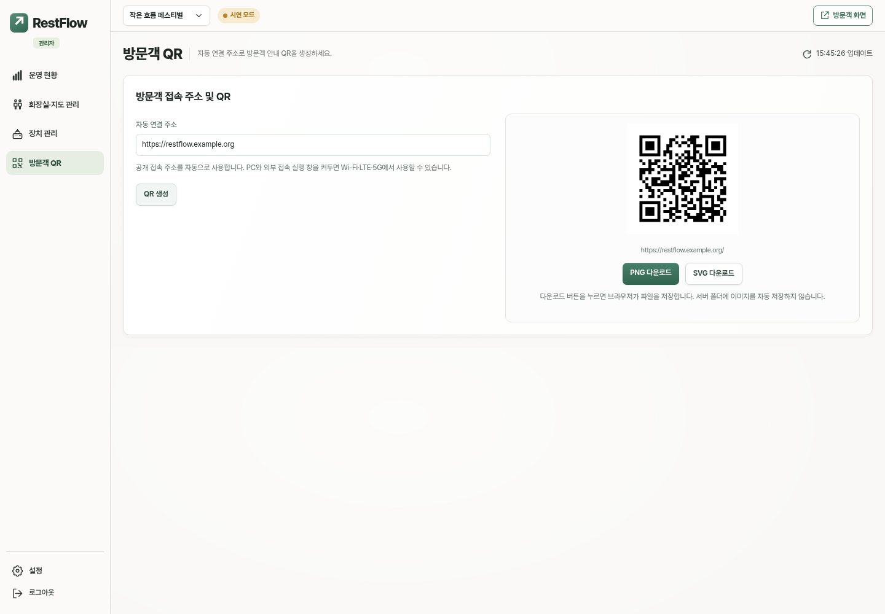

# 현재 화면 캡처

갱신일: **2026-11-10 (KST)**  
대상: `design/restflow-update-2026-11-10`

현재 브랜치의 실제 HTML/CSS/JavaScript를 Chromium으로 실행해 촬영했습니다. 데이터와 그래프는 가상 예시이며 QR의 `restflow.example.org` 주소도 설명용입니다. 실제 센서 측정값이나 외부 접속 검증 자료가 아닙니다.

| 화면 | 파일 |
| --- | --- |
| 방문객 PC — 추천순·추정 혼잡도 | [visitor-desktop.png](visitor-desktop.png) |
| 방문객 모바일 | [visitor-mobile.png](visitor-mobile.png) |
| 관리자 운영 현황 | [admin-desktop.png](admin-desktop.png) |
| 화장실·지도 통합 관리 | [admin-facilities.png](admin-facilities.png) |
| 장치 관리 — 연결된 화장실 이름 | [admin-devices.png](admin-devices.png) |
| 방문객 QR | [admin-qr.png](admin-qr.png) |
| 관리자 설정 | [admin-settings.png](admin-settings.png) |

## 방문객 PC

## 관리자 운영 현황

## 화장실·지도 관리

## 장치 관리

## 방문객 QR

