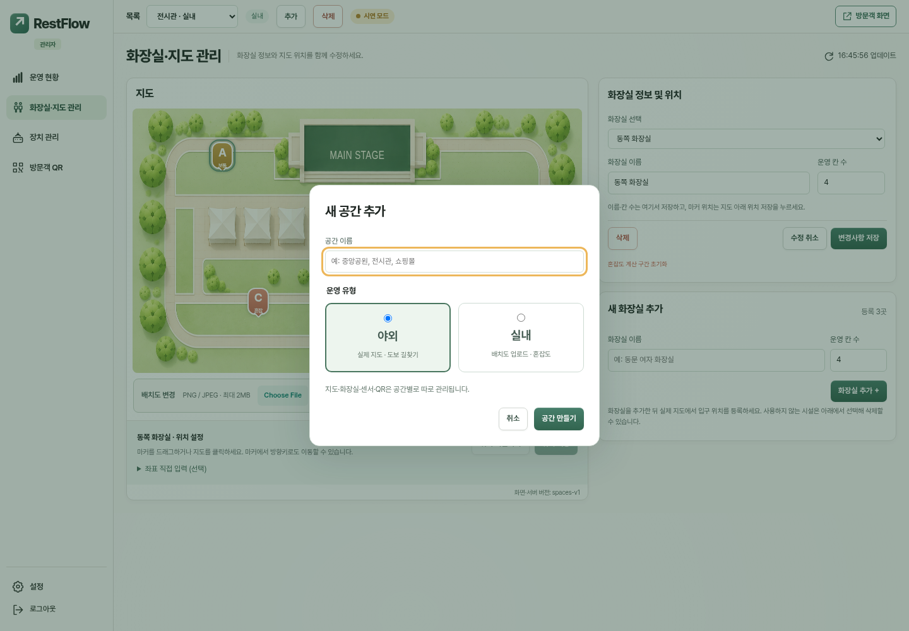
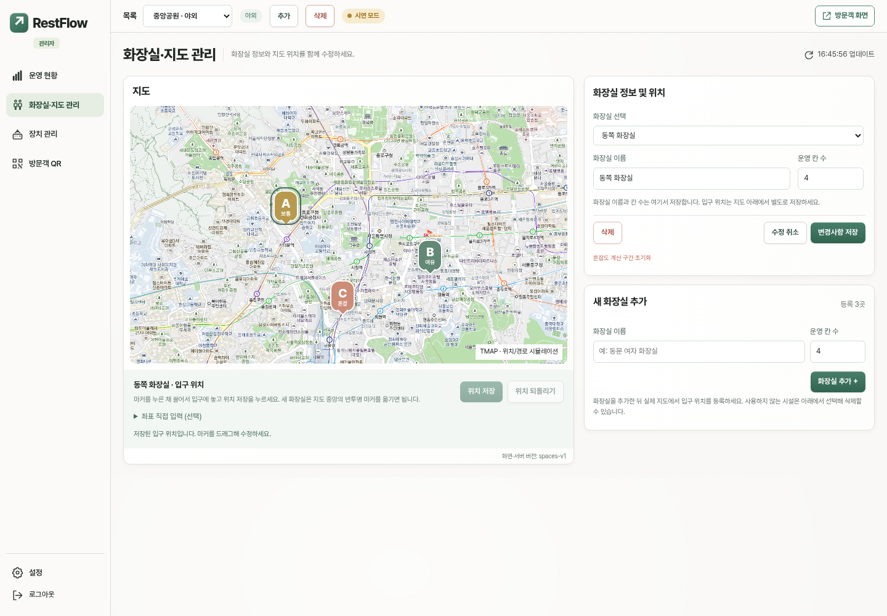
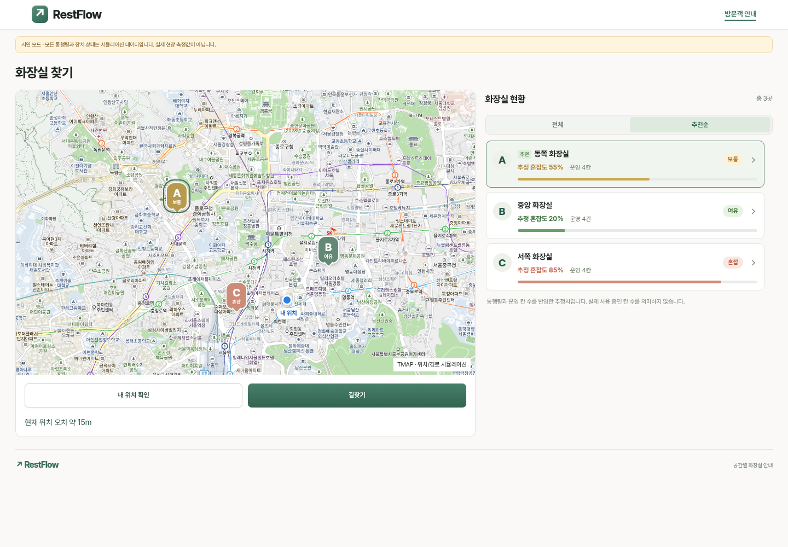
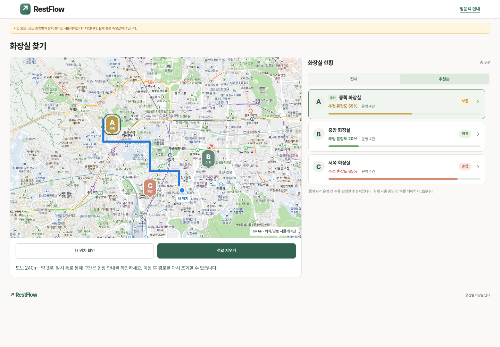

# 현재 화면 캡처

갱신일: **2026-11-13 (KST)**
대상: `feature/outdoor-tmap-navigation` · `2026-11-13-spaces-v1`

현재 브랜치의 HTML/CSS/JavaScript를 Chromium으로 실행해 촬영했습니다. 공간·화장실·통행량·장치 상태는 가상 예시입니다. 야외 지도는 TMAP 공개 타일을 배경으로 사용하며, 마커 위치·GPS·경로 응답은 시뮬레이션입니다. 실제 위치 정확도나 도보 경로 검증 자료가 아닙니다. QR의 `restflow.example.org` 주소도 설명용입니다. 실제 API 키와 장치 토큰은 포함하지 않았습니다.

| 화면 | 파일 |
| --- | --- |
| 관리자 운영 현황 — 실내 | [admin-desktop.png](admin-desktop.png) |
| 화장실·지도 관리 — 실내, 지도 아래 위치 저장 바 | [admin-facilities.png](admin-facilities.png) |
| 화장실·지도 관리 — 야외, 입구 위치 저장 바 | [admin-outdoor.png](admin-outdoor.png) |
| 공간 추가 — 실내·야외 유형 선택 | [admin-add-space.png](admin-add-space.png) |
| 장치 관리 | [admin-devices.png](admin-devices.png) |
| 공간별 방문객 QR | [admin-qr.png](admin-qr.png) |
| 관리자 설정 | [admin-settings.png](admin-settings.png) |
| 실내 방문객 PC | [visitor-desktop.png](visitor-desktop.png) |
| 실내 방문객 모바일 | [visitor-mobile.png](visitor-mobile.png) |
| 야외 방문객 — 마커 선택, 길찾기 전 | [visitor-outdoor.png](visitor-outdoor.png) |
| 야외 방문객 — 경로 표시, 경로 지우기로 전환 | [visitor-outdoor-route.png](visitor-outdoor-route.png) |
| 야외 방문객 모바일 — 경로 표시 | [visitor-outdoor-mobile.png](visitor-outdoor-mobile.png) |

## 공간 추가

## 실내 지도 관리

## 야외 지도 관리

## 야외 방문객 길찾기 전·후

## 실내 방문객

## 공간별 QR

